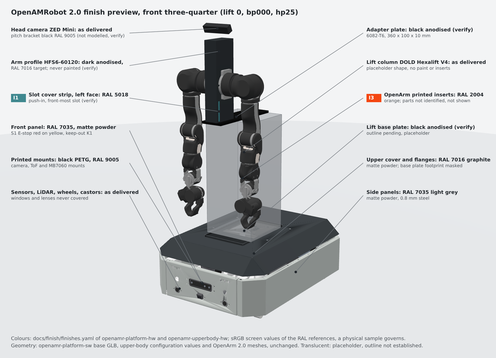

# Finish and trim plan, mobile base (OpenAMRobot 2.0 prototype)

> **Status:** proposal for the 2.0 prototype, cosmetic only. Nothing here changes the shape, dimensions,
> position, function or material of any part, the CAD, the BOM quantities or the decisions register.
> Items marked **verify** name the drawing, measurement or confirmation they need. The work-package owner
> adopts, adapts or rejects this plan.

This folder covers the parts owned by this repository: the mobile base (MMP.* parts and the purchased
parts mounted on it). The upper body (lift base plate, lift column, adapter plate, arm profile and its
slot covers, OpenArm 2.0 parts, head camera bracket) is covered by the same set of files in
[openamr-upperbody-hw `docs/finish/`](https://github.com/openAMRobot/openamr-upperbody-hw/tree/main/docs/finish).
Both `finishes.yaml` files use one schema, one palette and unique ids, so the robot model can read both.

| File | Content |
|---|---|
| [finish-schedule.md](finish-schedule.md) | One row per part or surface: part number, GLB node id, location, material and current finish, proposed colour, process, masking and assembly notes |
| [insert-schedule.md](insert-schedule.md) | Inserts and trims, keep-out rules, excluded trims |
| [finishes.yaml](finishes.yaml) | Machine-readable map from GLB node id to colour (RAL and sRGB), finish and status; the single source for the model |
| [masking-and-assembly.md](masking-and-assembly.md) | Which parts are finished before assembly, what is protected, in which order |
| [feasibility.md](feasibility.md) | Now, needs CAD confirmation, needs supplier confirmation, needs a fit check |
| [renders/](renders/) | Annotated preview renders of the whole robot with the colours of both files |
| [tools/](tools/) | Table generator and checker, preview scene builder and renderer (identical in both repositories) |

## Previews

Front three-quarter and rear three-quarter, lift at 0, base plate position `bp000`, head pitch `hp25`.
Translucent parts are placeholders where the model has no geometry yet (lift column, lift base plate).




## Design direction

Restrained and engineering-led. Large areas are neutral; accents are few and small and live only on
the upper body (insert schedule I1 to I3). The mobile base carries no accent colour.

| Role | Colour | RAL | sRGB (screen) | Where on the base |
|---|---|---|---|---|
| Body panels | light grey | RAL 7035 | `#CBD0CC` | side, front and rear panels (MMP.00.00.00.001 to .003) |
| Upper cover | graphite | RAL 7016 | `#383E42` | cover and both cover flanges (MMP.01.00.00.001, .002) |
| Small printed parts | black | RAL 9005 | `#0A0A0A` | camera, TF-Luna, MB7060 mounts, LiDAR spacer, driver mount |
| Internal steel | white, unchanged | RAL 9016 | `#F6F6F6` | base plate, centre bracket, supports, LiDAR support (as drawn) |
| Accent 1 | orange | RAL 2004 | `#F44611` | none on the base (OpenArm printed inserts, upper body) |
| Accent 2 | cyan | RAL 5018 (verify against a physical sample) | `#3F888F` | none on the base (arm profile slot covers, upper body) |

sRGB values are screen approximations for the model and the renders; a physical RAL sample governs
the order.

## Process by material

The current drawings (MMP.00, MMP.01, MMP.02, MMP.04, MMP.05, MMP.07) all state steel sheet
EN 1.0114 and note 8 "Coating: enamel powder white, glossy RAL 9016". Every row in the finish schedule
starts from that material.

| Material | Process | Notes |
|---|---|---|
| Steel sheet EN 1.0114 (0.8, 1.2, 2.0 mm) | polyester powder coat after bending and deburring, fine texture matte | rivet nuts set before coating only with the thread protected (CAD README); the drawing note 8 changes only when the drawing owner revises it |
| Printed PETG | print in coloured filament (black, close to RAL 9005); no paint | heat-set inserts after printing |
| Aluminium (none on the base today; see the LiDAR spacer verify item) | as machined or anodised | never painted |
| Purchased parts | as delivered | hub motors, castors, sensors, compute, controller, driver, battery, E-stop, RESET |

## Never finished or covered

Threads and rivet nuts; grounding and bonding points; bolted mating faces; bearings, shaft flats and
brake housings; sliding or telescoping surfaces; labels and safety markings; sensor apertures and
lenses (MB7060 transducers, TF-Luna lenses, RPLIDAR S3 scan window, Gemini 336L windows); cooling
paths (Jetson heatsink and fan, ZLAC8015D fins, any cover opening). No rubber edge protectors and no
bumper strips are added.

## Safety colours (rule K1)

The base E-stop (S1, Schneider XB4BS8445 with ZBE-102, front panel) stays red on its yellow legend and
the RESET button (Schneider XB4BW36B5) stays its standard blue. No orange or cyan accent is placed within
150 mm of either bezel edge, measured on the surface, and no accent is placed on the panel that carries
them. The base has no accents, so K1 is met by design on the base; it also applies to the chest E-stop on
the upper body. The RESET position is not in the v0.2 CAD (verify).

## Sources

| Source | Revision used |
|---|---|
| CAD v0.2 full assembly and production files, this repository | `mechanical/cad/` at `eaac115` (drawings MMP.* with material and sheet thickness) |
| Mechanical BOM, 3D-printed parts | `manufacturing/bom/mechanical-bom.md` at `eaac115` |
| OpenAMRobot 2.0 Detailed Hardware BOM | Issue 7.13 draft, 25 October 2026 (rows MEC-001 to MEC-021, SAF-001, SAF-005, ARM-001 to ARM-011). The register entry BOM-ISSUE-IN-FORCE names Issue 7.10; confirm the cited rows against the issue in force |
| Model part list | openamr-platform-sw `9a58e0b` (#96), `ros2/src/openamrobot_description/meshes/PROVENANCE.yaml`, 44 GLB nodes |
| Model GLB for the previews | regenerated with `tools/cad/step_to_description_meshes.py` at `9a58e0b`; sha256 `fb41c555...0796b7b0`, identical to PROVENANCE.yaml |
| Upper body | openamr-upperbody-hw `docs/mechanical/upper_body_option_B.md` at `6349ff2`; openamr-upperbody-sw configuration at `f57e54c` |
| Decisions register | openAMRobot/.github `decisions.yaml` at `68ba70b` |
| E-stop wiring scope | open draft openamr-platform-hw #27 (two E-stops: S1 base front, S2 chest) |

## Regenerating the tables and previews

```bash
# finish-schedule.md table and checks (both files, all 44 GLB nodes covered)
python3 docs/finish/tools/finish_tables.py docs/finish/finishes.yaml \
  --companion ../openamr-upperbody-hw/docs/finish/finishes.yaml \
  --provenance ../openamr-platform-sw/ros2/src/openamrobot_description/meshes/PROVENANCE.yaml \
  --write docs/finish/finish-schedule.md

# previews: build the base GLB with openamr-platform-sw tools/cad (see its README), then
python3 docs/finish/tools/build_preview_scene.py --base-finishes docs/finish/finishes.yaml \
  --upper-finishes ../openamr-upperbody-hw/docs/finish/finishes.yaml \
  --glb ../openamr-platform-sw/build/base_visual.glb \
  --upper-config ../openamr-upperbody-sw/ros2/src/openamrobot_upperbody_description/config/upperbody_configuration.yaml \
  --openarm ../openarm_description --stage /tmp/finish-stage
npm install three@0.160.0
node docs/finish/tools/render_preview.mjs /tmp/finish-stage node_modules/three docs/finish/renders
```

The OpenArm 2.0 meshes come from `enactic/openarm_description` at `81fe647` (Apache-2.0); they are
used only to render and are not copied into this repository.
