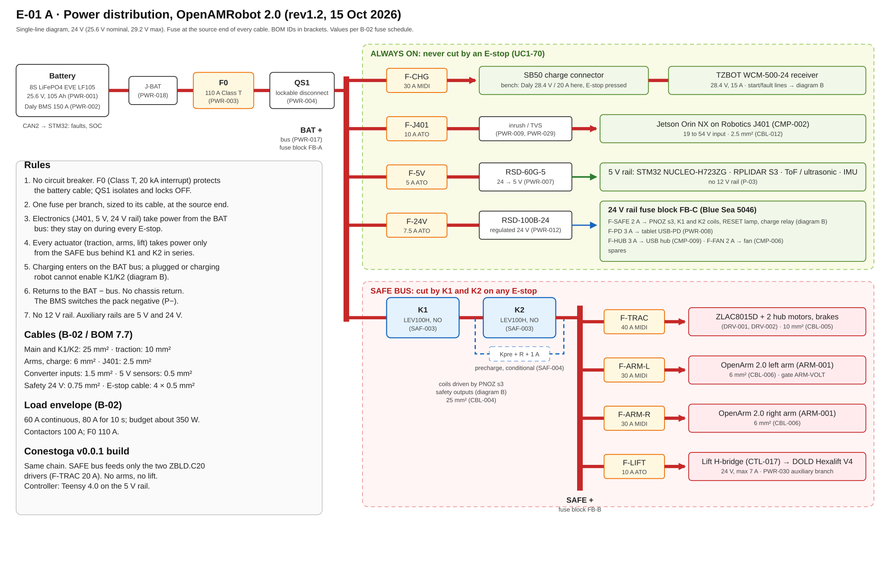
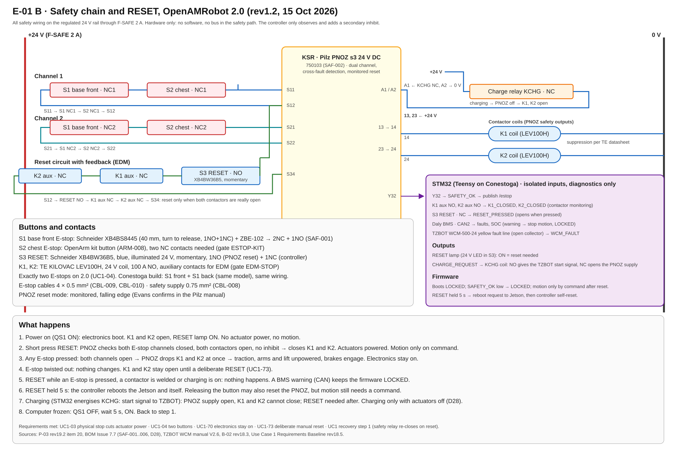

# E-01 safety chain and power distribution

*Baseline E-01, decided 15 October 2026. Diagrams E-01 A rev1.2 and E-01 B rev1.2.*

## Purpose

This page is the defined fused and E-stop-protected layout for builders. It applies to:

- **OpenAMRobot 2.0** (Dev cycle 2, Use Case 1): the target design.
- **The Conestoga v0.0.1 build**: the same safety chain with the differences listed in
  [Conestoga v0.0.1 build](#conestoga-v001-build).

Source of truth: P-03 rev19.2 item 20, the E-01 baseline and diagrams E-01 A rev1.2 and
E-01 B rev1.2. E-01 supersedes CS-02 rev1.0. The existing v0.0.1 robot as built and measured is
described in [power.md](power.md) and [safety.md](../../safety/safety.md); that content is not
changed by E-01.

> **Design baseline, not a test record.** Nothing on this page has been built or tested on a
> robot yet. The [open gates](#open-gates) must close before parts are ordered. Firmware status,
> telemetry and BMS data are functional; they are never safety evidence.

## Diagrams

## Power distribution

1. **No circuit breaker.** Main protection is one Class T fuse **F0** (Blue Sea 5112, 110 A,
   20 kA interrupt) right after the battery, then a lockable disconnect **QS1** (Blue Sea
   BS-6004B, 300 A, key lock in OFF). F0 is 110 A instead of the 100 A in B-02 (approved by Alex,
   15 Oct 2026).
2. **One fuse per branch**, at the source end, sized to its cable (table below).
3. **Fuse blocks:** FB-A battery bus (Blue Sea SafetyHub 150, 7748), FB-B safe bus (SafetyHub 150,
   7748), FB-C regulated 24 V rail (Blue Sea 5046).
4. **Electronics are always on.** The Jetson, the 5 V rail and the regulated 24 V rail take power
   from the battery bus. An E-stop never cuts them.
5. **Actuators only behind the contactors.** Traction, both arms and the lift take power from the
   SAFE bus behind K1 and K2 in series. Arms and wheels run at battery voltage (20 to 29.2 V), not
   through a converter.
6. The regulated 24 V converter (RSD-100B-24) feeds only the safety circuit and small loads
   (tablet, USB hub, fan). It does not feed wheels or arms.
7. **No 12 V rail. No chassis return**; every load returns to the BAT minus bus.
8. Precharge across K2 stays conditional: fitted only if the measured SAFE bus capacitance needs it.

### Fuse table

| Branch | Fuse | Cable |
|---|---|---|
| Main | F0 110 A Class T | 25 mm2 |
| Charge | F-CHG 30 A MIDI | 6 mm2 |
| Jetson J401 | F-J401 10 A ATO | 2.5 mm2 |
| 5 V converter RSD-60G-5 | F-5V 5 A ATO | 1.5 mm2 |
| 24 V converter RSD-100B-24 | F-24V 7.5 A ATO | 1.5 mm2 |
| Traction ZLAC8015D | F-TRAC 40 A MIDI (Conestoga 20 A) | 10 mm2 |
| Left arm, right arm | F-ARM-L, F-ARM-R 30 A MIDI each | 6 mm2 |
| Lift | F-LIFT 10 A ATO | 1.5 mm2 |
| Safety circuit (PNOZ, coils, lamp, charge relay) | F-SAFE 2 A ATO | 0.75 mm2 |
| Tablet, USB hub, fan | 3 A, 3 A, 2 A ATO | per load |

## Safety chain

The safety chain is hardware only: no software and no bus in the safety path. The controller only
observes it and adds a secondary inhibit.

1. **Exactly two E-stops:** S1 base front, Schneider XB4BS8445 plus ZBE-102 (2NC + 1NO); S2 chest,
   the OpenArm kit button (two NC contacts needed). Both are wired dual channel.
2. **Safety relay KSR:** Pilz PNOZ s3 24 V DC (750103), dual channel, cross-fault detection,
   monitored reset. It replaces the two automotive relays of CS-02.
3. **Contactors K1 and K2:** TE KILOVAC LEV100H, 24 V coil, 100 A, normally open, with a
   mechanically linked auxiliary contact. LEV100A5ANG is not ordered (no auxiliary).
4. Both contactors are held closed by the PNOZ outputs 13-14 and 23-24. A pressed E-stop, a broken
   wire, a blown fuse or lost power opens both.
5. **Contactor feedback:** the K1 and K2 auxiliary NC contacts are in series in the reset circuit
   (S12, RESET, K1 aux, K2 aux, S34). The PNOZ refuses to reset if a contactor is welded.
6. An E-stop cuts actuator power only. Electronics stay on.
7. After any stop or power-up, power never returns by itself. Only a deliberate RESET closes K1 and
   K2, and motion still needs a command.
8. Brakes on the hub motors are released from the SAFE bus side, so an E-stop also engages the
   brakes.

### One RESET button

1. One button only: Schneider XB4BW36B5 (blue, illuminated 24 V, momentary, 1NO + 1NC).
2. **NO contact:** PNOZ monitored reset. A short press resets the safety chain.
3. **NC contact:** controller input. Held 5 s, the controller asks the Jetson to reboot, then resets
   itself.
4. Lamp ON means reset needed. Hard restart if the computer freezes: QS1 OFF, wait 5 s, ON.
5. This replaces the separate electronics reset in the earlier docs (recorded in P-03 item 20).

## Charging

1. Wireless charging is the 2.0 charging path: **TZBOT WCM-500-24** (24 V class, 8 to 15 A),
   ordered with **28.4 V** output after TZBOT confirms it in writing. About 6 h for 84 Ah at
   **15 A**.
2. The robot is designed, wired and documented complete for it, even if the unit arrives later:
   receiver mount, SB50 charge connector, F-CHG 30 A, charge relay, fault input.
3. The wired charge inlet (PWR-019) and the charge plug-presence switch (PWR-020) are removed.
4. **Bench charger:** until the TZBOT unit arrives, the Daly 28.4 V / 20 A charger (PWR-005) plugs
   into the same SB50 connector for bench charging, with the E-stop pressed.
5. **Charge relay KCHG interlock** (24 V coil, 1NO + 1NC), driven by the controller: NO puts 24 V on
   the TZBOT brown start line; NC opens the PNOZ supply (terminal A1), so actuators cannot be enabled
   while charging and a RESET is needed after. The TZBOT has no interlock of its own, so this relay
   is required.
6. TZBOT yellow fault line (open collector, max 30 V, 200 mA) to a controller input with pull-up.
7. Docking stays positioning only, no contacts.
8. The WCM-300 (28.8 V, 7 A fixed) is not used on 2.0: 28.8 V is 3.60 V per cell, the over-voltage
   trip point, and 7 A gives about 12 h.

## Battery

1. Primary: 8S EVE LF105 LiFePO4 (25.6 V, 105 Ah) with the Daly M-series 150 A BMS. The LiTech
   custom pack is the second option.
2. **Battery faults reach the STM32 over CAN2** (isolated). On a BMS warning the STM32 stops motion
   and locks. On a hard fault the BMS disconnects the pack itself.
3. The hardwired BMS RUN_OK contact (D26) is dropped.

## Conestoga v0.0.1 build

1. Same safety chain and parts: PNOZ s3, two LEV100H, two XB4BS8445 E-stops (front and back), one
   XB4BW36B5 RESET, same wiring.
2. Controller: Teensy 4.0 with the same signals and behaviour as the STM32.
3. SAFE bus feeds only the two ZBLD.C20 drivers, F-TRAC 20 A. The build has no arms and no lift column.
4. Their own TZBOT WCM-300 through the same charge relay; check their battery's full-charge voltage
   against the fixed 28.8 V output, and the 220 V input.
5. CS-02 rev1.0 is superseded by E-01.

## Open gates

These are not decisions; they are checks before ordering.

1. LEV100H 24 V variant with mechanically linked auxiliary (EDM-STOP).
2. OpenArm chest E-stop: two NC contacts, pinout (ESTOP-KIT, Q-15).
3. OpenArm supply voltage up to 29.2 V while charging (ARM-VOLT). If not accepted, each arm needs
   its own 24 V converter sized for about 30 A.
4. Daly BMS CAN protocol and warning thresholds for the delivered order code.
5. TZBOT WCM-500-24 written confirmation: 28.4 V output, 15 A, signal wiring, 230 V input.
6. ZLAC8015D DC input rating and brake coil data (Q-03, Q-04).
7. DOLD lift holding on E-stop and power loss (UC1-14).
8. PNOZ s3 reset mode (monitored, falling edge) checked by Evans in the Pilz manual.
