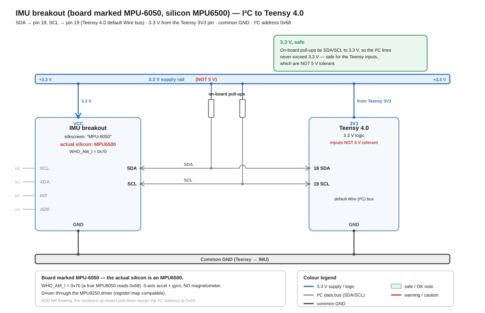

# IMU: ICM-42688-P (2.0) and MPU6500 (Gate A unit)

*Last updated: 2026-10-12.*

## 2.0 IMU: TDK InvenSense ICM-42688-P (MIKROE-4237)
The OpenAMRobot 2.0 IMU is the **ICM-42688-P** on the **MIKROE-4237 6DOF IMU 14 Click** board. Source:
P-03 Decision Addendum rev19.0 item 19 (12 Oct 2026); geometry from STEP MMP.00.00.00.000.

| | |
|---|---|
| Chip / board | **ICM-42688-P** (3-axis accel + 3-axis gyro), MikroElektronika **MIKROE-4237** 6DOF IMU 14 Click |
| Bus | **dedicated SPI**, **Mode 0**, clock **at most 8 MHz** |
| Data path | **data-ready interrupt with DMA** |
| `WHO_AM_I` | **0x47** (checked at boot) |
| Frame | `imu_link` on the centreline at **x 0.0544 m**, **z 0.133 m** from `base_link` (54.4 mm in front of the drive axle, 177 mm above the base plate top, 231 mm above the floor); axes aligned with `base_link` |
| Mount | on the electronics bracket MMP.04.00.00.002, CAD 2026-10-15. Was x 0.195 m on the base plate (Alex decision 2026-10-12) |

The rest of this page documents the **Gate A unit** IMU (MPU6500).

## Gate A unit: MPU6500

## Overview
An inertial measurement unit (accelerometer + gyroscope) on the Teensy's I²C bus. Used to improve
heading (yaw) estimation for navigation.

> ⚠️ **Important (Gate A unit)**: the board was labeled / assumed to be an **MPU6050**, but it is actually an
> **MPU6500**. This caused a lot of confusion (see below).

| | |
|---|---|
| Chip | **MPU6500** (3-axis accel + 3-axis gyro), Gate A unit |
| Bus | I²C, address **0x68** (AD0 = GND) |
| `WHO_AM_I` (reg 0x75) | **0x70** (an MPU6050 would return 0x68; Gate A unit) |
| Magnetometer | none (MPU6500 has no mag; the MPU9250 would) |

## Communication (I²C → Teensy) — wiring VERIFIED 2026-06-19

The I²C wiring is shown in the diagram below.

- `SDA = pin 18`, `SCL = pin 19` (Teensy 4.0 default `Wire`) — confirmed on the board.
- **Supply = 3.3 V** (measured), `AD0 = GND` → address **0x68**, `GND` common with the Teensy.
- The Teensy is the I²C master; the IMU answers at 0x68.
- The firmware reads acceleration and rotation rate; it publishes raw IMU on **`/imu/data_raw`**
  (`sensor_msgs/Imu`) plus **`/imu/mag`** (`sensor_msgs/MagneticField`, see the no-magnetometer note
  below). The **filtered `/imu/data`** is produced host-side (Madgwick/EKF), not by the firmware.
  *(Older revisions of this doc said the firmware publishes `/imu/data` directly — that is outdated;
  the deployed 2026-06-29 firmware publishes `/imu/data_raw` + `/imu/mag`.)*

> ✅ **No level-shift issue here** (unlike the encoders): the GY-521 board runs on **3.3 V**, so its
> on-board I²C pull-ups pull to 3.3 V → SDA/SCL never exceed 3.3 V → safe for the Teensy 4.0.
> Unused pins: `XCL`, `XDA` (auxiliary I²C), `INT` (data-ready interrupt).

## Firmware driver — the fix
Gate A unit: the **MPU6050** driver checks `WHO_AM_I == 0x68` and **rejects** our chip (which returns 0x70)
→ `setup()` used to hang (LED 3 blinks, no topics). The fix:

- Use **`USE_MPU9250_IMU`** in `lino_base_config.h` (instead of `USE_MPU6050_IMU`).
- The MPU9250 driver accepts it: it reads `WHO_AM_I` bits [6:1]; `0x70` → `0x38`, which its
  `testConnection()` accepts (`MPU9250.cpp`). The MPU6500 is register-compatible with the MPU9250 core
  (accel+gyro), so it works.

## Status (verified)
- ✅ `/imu/data_raw` publishes **real data**: at rest, `linear_acceleration.z ≈ 9.74 m/s²` (gravity).
- ⚠️ `/imu/mag` is published for message-shape compatibility only — the MPU6500 has **no magnetometer**,
  so it carries no real magnetic field; do not fuse it as a heading source.
- The `linear_acceleration.x ≈ -2` at rest means the IMU is **mounted at a slight tilt** (to account for
  in the URDF later).

## Fusion in the EKF (done 2026-06-18)
The IMU is now fused by the `robot_localization` **EKF** (`~/ekf.yaml`) — but **only `angular_velocity.z`**
(yaw rate). Measured behaviour at rest (robot perfectly still): gyro X/Y/Z biases are tiny, and **gyro Z
reads ~0 with a firmware deadband** → no heading drift on straight lines. During an actual turn, gyro Z
**tracks the real rotation** closely (verified against wheel odometry, e.g. both ≈ −25 °/s while turning).
Conclusion: the gyro Z is healthy and the fusion mainly **reduces heading drift in turns** (where wheels
slip). The accelerometer is **not** used (tilted mount + only yaw matters in 2D). See
the `openamr-platform-sw` navigation/architecture docs.

> ⚠️ Measure the bias only when the robot is **strictly immobile** — moving it during the capture gives a
> bogus (even sign-flipping) bias reading.

## Good to know / gotchas
- **No orientation**: the driver provides raw accel + gyro only; the orientation quaternion in
  `/imu/data_raw` is all zeros (invalid). For sensor fusion (EKF / `robot_localization`), use the
  **angular velocity** (`angular_velocity.z`, yaw rate), not the orientation.
- A tiny standalone I²C scanner project on the reference Pi (`~/i2cscan`) can re-check the bus /
  address (`WHO_AM_I`) if needed.
- The firmware default scales: accel ±2 g (`1/16384`), gyro ±250 °/s (`1/131`).
